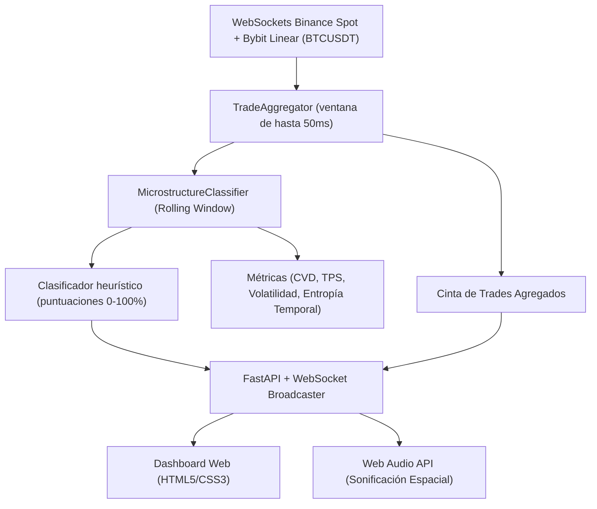

# OrderFlowAI ⚡
### Motor de Inferencia de Flujo de Órdenes & Sonificación en Tiempo Real

**OrderFlowAI** es una plataforma de análisis cuantitativo de microestructura de mercado y sonificación acústica para Bitcoin (`BTC/USDT`), diseñada para detectar en tiempo real:
1. **Ejecución Algorítmica Institucional** (TWAP / VWAP / Slicing).
2. **Iceberg Orders** (Comprador o Vendedor con recarga pasiva oculta).
3. **Market Maker Absorbiendo** (Presión agresiva neutralizada sin desplazamiento de precio).
4. **Trading Minorista Dominante** (Órdenes pequeñas fragmentadas).
5. **Alta Competencia HFT** (Ráfagas violentas de microsegundos en ambos lados de la cinta).

---

## 🏗 Arquitectura del Sistema



---

## 🎯 Firmas de Microestructura Detectadas

| Patrón | Métrica Cuantitativa | Comportamiento en la Cinta |
| :--- | :--- | :--- |
| **Ejecución algorítmica (heurística)** | Regularidad temporal (60 %) y uniformidad del tamaño en USD (40 %) | Cadencia y tamaños regulares; no identifica la estrategia ni al operador. |
| **Iceberg posible** | Más del 22 % del volumen en un precio redondeado a 0.1, con al menos 6 grupos | Concentración ejecutada en un nivel; sin libro de órdenes no confirma liquidez oculta. |
| **Absorción posible** | Al menos $200k$ de volumen, ratio $|CVD| / \text{Volumen} > 35\%$ y desplazamiento inferior a 1.5 bps | Desequilibrio agresivo con poco desplazamiento del precio. |
| **Actividad rápida / alternancia** | Más de 60 grupos por segundo; puntaje combina TPS y alternancia | Ráfagas en la cinta, no identificación de HFT. |
| **Breakout** | Desplazamiento superior a 6 bps y desequilibrio de volumen superior a 40 % | Movimiento acompañado por presión direccional. |
| **Puntuación retail** | Inversa a la mayor puntuación de algoritmo, iceberg, absorción o HFT | No clasifica directamente tamaños ni identidades minoristas. |

> Las puntuaciones actuales son heurísticas, no probabilidades estadísticas calibradas. Los datos públicos de trades no incluyen el libro de órdenes y no permiten confirmar directamente órdenes iceberg, identidad institucional ni actividad HFT. El panel de información del dashboard describe las reglas y sus limitaciones.

## 🧪 Captura, señales y backtesting de scalping

El modo inicial se define en `CONFIG.classifier.default_inference_mode` en `config.py` (actualmente `model`). En modo entrenado, el servidor carga `data/hmm_regime_model.json`; si no puede cargar el artefacto, inicia en modo heurístico e indica el modo efectivo en el dashboard. Usa el botón **MODO** del panel para alternar entre el HMM entrenado y las reglas heurísticas; la página confirma el cambio o muestra el error. Al volver al modo HMM, el estado de inferencia se reinicia.

Después del calentamiento, SQLite guarda un snapshot por segundo de las métricas/features, puntuaciones heurísticas y configuración versionada. Las observaciones de scalping se capturan exclusivamente de Bybit Linear; Binance Spot sigue participando en el clasificador general, pero no se mezcla en las entradas/performance del backtest. Los registros anteriores se migran como `legacy_combined` y se excluyen del backtest nuevo. La base está en `data/orderflow.sqlite3` y no tiene borrado automático.

El panel **Setups de scalping BTCUSDT · Bybit Linear** permite seleccionar hipótesis y hacer backtesting paper, sin envío de órdenes:

1. Deja correr la captura de Bybit hasta reunir al menos 51,429 snapshots (aproximadamente 14.3 horas): así el primer 70 % contiene 36,000 observaciones para entrenamiento y queda un 30 % posterior para validación. Fourier puede requerir más velas completas según la temporalidad seleccionada.
2. Selecciona la estrategia, temporalidad de 5, 10 o 15 minutos y dirección original/invertida, y pulsa **Optimizar y validar backtest**. La variante invertida conserva los mismos timestamps de entrada y voltea LONG↔SHORT antes de volver a simular las salidas; también vuelve a seleccionar SL/TP solo en entrenamiento. `Flujo + momentum` es la línea base; `Fourier: anomalía + ruptura` busca residuo anómalo, contexto de transición y ruptura posterior; `Volumen excepcional + tendencia` requiere volumen snapshot elevado, EMA rápida/lenta alineada y desequilibrio del flujo en la misma dirección.
3. Las variantes se prueban con datos Bybit, salidas por SL/TP basados en ATR o tiempo, y una división cronológica 70/30. Se busca la mejor combinación de SL/TP dentro del tramo de entrenamiento; el tramo de validación no participa en esa selección. Comisión taker y slippage por lado son configurables en `CONFIG.scalping` (`config.py`) y se descuentan como costo ida/vuelta. El dashboard compara expectativa bruta/neta en entrenamiento y validación, y desglosa validación por long/short y stop/objetivo/salida por tiempo.
4. El Fourier de esta versión es una adaptación de corto plazo (ciclos de 8 y 24 velas, ventana de 48 y mínimo de 72 velas de entrenamiento); no replica literalmente las entradas en días ni todos los filtros del script Pine. Requiere dos anomalías residuales consecutivas con |z| > 2.7, zona cerrada, contexto válido y ruptura; puede no generar entradas aunque el número mínimo de velas se haya alcanzado. El panel reporta anomalías, zonas, rupturas y operaciones simuladas para distinguir falta de señales de falta de historial. Las velas OHLC se reconstruyen de snapshots de precio de 1 segundo; el volumen es una tasa proxy derivada de una ventana móvil de trades. La detección de volumen no identifica wallets ni operadores whale. No se incorpora aún SP500/VIX.
5. Solo la estrategia base original puede activar señales live; direcciones invertidas, Fourier y volumen+tendencia se mantienen como backtests de investigación, no activan señales live ni órdenes. Compara original e invertida usando el mismo corte temporal; no escojas repetidamente por el mismo conjunto de validación porque se convierte en ajuste a la muestra. Resultados pasados no garantizan rendimiento futuro.

Esta primera versión es experimental, no una recomendación ni garantía de rentabilidad. El backtest usa snapshots de precio de 1 segundo; no incluye funding, latencia, cola de ejecución ni impacto real de mercado, y una muestra corta puede sobreajustarse. No se conectan endpoints privados ni se colocan órdenes.

Para reentrenar el HMM de clasificación de regímenes con la base:

```bash
python -m src.ml.train_hmm
```

El entrenamiento requiere al menos 100 observaciones guardadas. Al terminar, reinicia el servidor para cargar el artefacto actualizado.

Para cada snapshot Bybit Linear, se registran retornos futuros a 5, 30 y 60 segundos y a 5, 10 y 15 minutos en puntos básicos. Se etiquetan como reversión, continuación o neutral respecto a la dirección del CVD inicial; movimientos inferiores a 1 bp son neutrales. Son etiquetas de resultado derivadas del precio, no ground truth de intención del mercado.

---

## 🎧 Sonificación Acústica Procedural (Web Audio API)

El motor acústico integrado en el navegador permite "escuchar la cinta" (*tape sonification*) en tiempo real:
* **Canal Derecho (Stereo Pan +0.35):** Compras agresivas (*Market Buys* que golpean el Ask) en frecuencias armónicas agudas (520Hz – 880Hz).
* **Canal Izquierdo (Stereo Pan -0.35):** Ventas agresivas (*Market Sells* que golpean el Bid) en frecuencias graves (220Hz – 380Hz).
* **Whale Orders ($\ge \$100\text{k}$):** Golpe resonante de sub-bajo (45Hz – 110Hz).
* **Icebergs Detectados:** Doble tono campaniforme en intervalo armónico.
* **Absorción:** Acorde resonante con filtro paso-bajo que simula impacto contra un muro de liquidez.

---

## 🚀 Instalación y Puesta en Marcha

### 1. Requisitos Previos
* Python 3.9 o superior.

### 2. Configurar Entorno Virtual e Instalar Dependencias
Desde una terminal (PowerShell o CMD):

```bash
cd "C:\Users\PERSONAL\Documents\DEV\OrderFlowAI"

# Crear entorno virtual
python -m venv venv

# Activar entorno virtual
# En Windows PowerShell:
.\venv\Scripts\Activate.ps1
# En Windows CMD:
.\venv\Scripts\activate.bat

# Instalar dependencias
pip install -r requirements.txt
```

### 3. Iniciar el Servidor y Dashboard
```bash
python run.py
```
El navegador se abrirá automáticamente en:
👉 **`http://localhost:8000`**

Haz clic en el botón superior:
**🔊 "Activar Sonificación en Tiempo Real"** para habilitar el audio procedural en el navegador.

---

## 📂 Estructura del Código

* [`config.py`](file:///C:/Users/PERSONAL/Documents/DEV/OrderFlowAI/config.py): Configuración de pares, WebSocket URIs y umbrales matemáticos.
* [`src/core/trade_model.py`](file:///C:/Users/PERSONAL/Documents/DEV/OrderFlowAI/src/core/trade_model.py): Modelos de datos para trades, agregación y probabilidades.
* [`src/core/aggregator.py`](file:///C:/Users/PERSONAL/Documents/DEV/OrderFlowAI/src/core/aggregator.py): Agrupador sub-milisegundo para emular la cinta de SignificantTrades.
* [`src/core/classifier.py`](file:///C:/Users/PERSONAL/Documents/DEV/OrderFlowAI/src/core/classifier.py): Motor heurístico de puntuación de microestructura.
* [`src/core/market_data_store.py`](file:///C:/Users/PERSONAL/Documents/DEV/OrderFlowAI/src/core/market_data_store.py): Captura SQLite de features, configuración y resultados futuros.
* [`src/connectors/binance.py`](file:///C:/Users/PERSONAL/Documents/DEV/OrderFlowAI/src/connectors/binance.py): Conector asíncrono WebSocket a Binance Spot/Futures.
* [`src/api/server.py`](file:///C:/Users/PERSONAL/Documents/DEV/OrderFlowAI/src/api/server.py): Servidor FastAPI y WebSocket broadcaster.
* [`static/`](file:///C:/Users/PERSONAL/Documents/DEV/OrderFlowAI/static):
  * `index.html`: Dashboard con medidores de probabilidad y cinta de transacciones.
  * `js/audio.js`: Sintetizador Web Audio API espacial.
  * `js/app.js`: Cliente WebSocket y renderizado a 60 FPS.
  * `css/style.css`: Estilo oscuro Fintech / Trading Terminal.
* [`tests/test_classifier.py`](file:///C:/Users/PERSONAL/Documents/DEV/OrderFlowAI/tests/test_classifier.py): Suite de pruebas unitarias.
