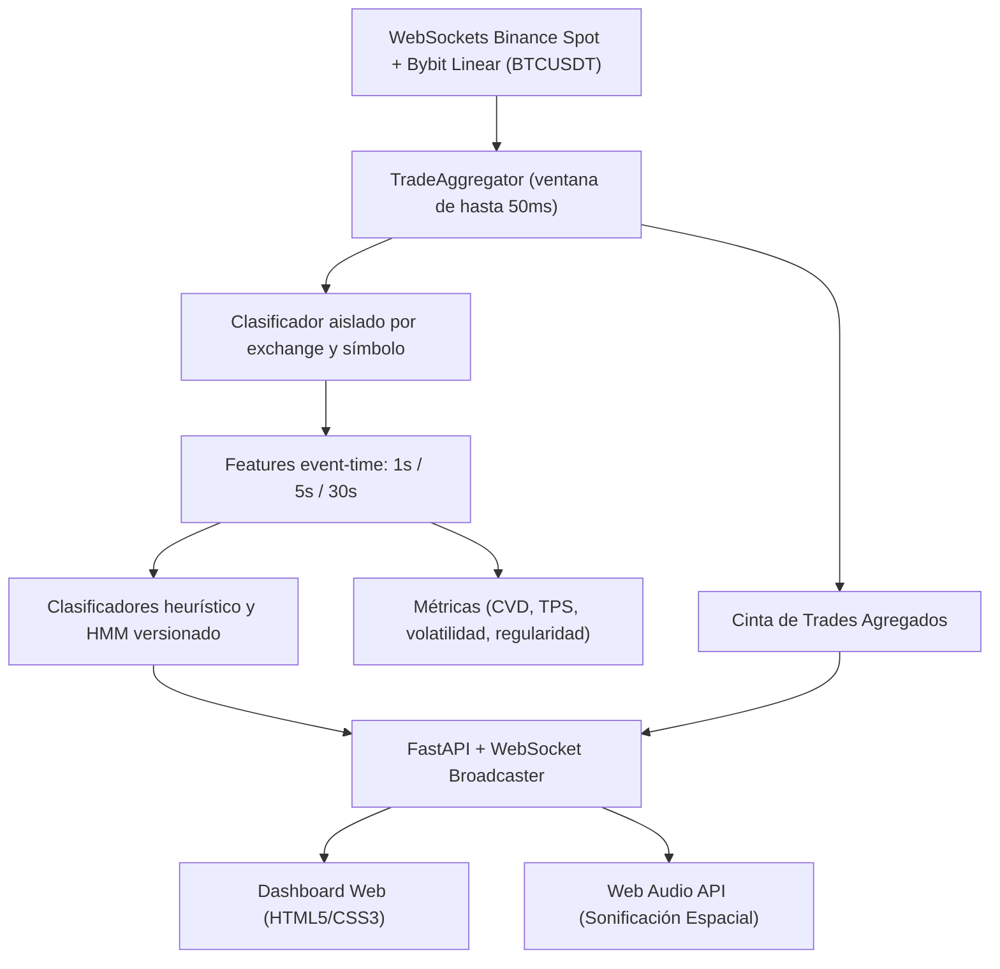

# OrderFlowAI ⚡
### Motor de Inferencia de Flujo de Órdenes & Sonificación en Tiempo Real

**OrderFlowAI** es una plataforma de análisis cuantitativo de microestructura de mercado y sonificación acústica para Bitcoin (`BTC/USDT`), diseñada para detectar en tiempo real:
1. **Ejecución Algorítmica Institucional** (TWAP / VWAP / Slicing).
2. **Iceberg Orders** (Comprador o Vendedor con recarga pasiva oculta).
3. **Market Maker Absorbiendo** (Presión agresiva neutralizada sin desplazamiento de precio).
4. **Trading Minorista Dominante** (Órdenes pequeñas fragmentadas).
5. **Alta Competencia HFT** (Ráfagas violentas de microsegundos en ambos lados de la cinta).

---

## 🏗 Arquitectura del Sistema



---

## 🎯 Firmas de Microestructura Detectadas

| Patrón | Métrica Cuantitativa | Comportamiento en la Cinta |
| :--- | :--- | :--- |
| **Regularidad temporal/tamaño** | CV de intervalos y tamaño sobre 30 s | Cadencia regular; no identifica la estrategia ni al operador. |
| **Concentración ejecutada por nivel** | Participación de volumen por precio sobre 30 s | Concentración observada; sin libro no confirma iceberg ni liquidez oculta. |
| **Flujo con baja respuesta de precio** | Desequilibrio y desplazamiento sobre 5 s | Proxy de posible absorción, no confirma órdenes pasivas. |
| **Ráfaga de actividad** | Eventos/s y alternancia sobre 1 s | Actividad rápida en la cinta; no identifica HFT. |
| **Impulso direccional** | Desplazamiento y flujo alineados sobre 30 s | Impulso observado; no confirma ruptura de un nivel. |
| **Puntuación retail** | Inversa a la mayor puntuación de algoritmo, iceberg, absorción o HFT | No clasifica directamente tamaños ni identidades minoristas. |

> Las puntuaciones actuales son heurísticas, no probabilidades estadísticas calibradas. Los datos públicos de trades no incluyen el libro de órdenes y no permiten confirmar directamente órdenes iceberg, identidad institucional ni actividad HFT. El panel de información del dashboard describe las reglas y sus limitaciones.

## 🧪 Captura, señales y backtesting de scalping

Cada clasificador mantiene estado separado por exchange y símbolo. El panel principal y las observaciones de scalping usan Bybit Linear; Binance Spot no contamina sus features. Las métricas se calculan sobre ventanas de tiempo de evento fijas de 1, 5 y 30 segundos, y la clasificación espera una ventana completa de 30 segundos y al menos 25 eventos. El modo inicial se define en `CONFIG.classifier.default_inference_mode` en `config.py` (actualmente `model`). El HMM solo se carga si su artefacto declara el esquema de features actual; los modelos anteriores se rechazan y el servidor inicia en modo heurístico hasta reentrenar. Usa el botón **MODO** del panel para alternar el clasificador principal entre el HMM compatible y las reglas heurísticas.

Las cinco tarjetas de clasificación muestran el valor actual y una serie temporal de la última hora, consultada de SQLite y refrescada con el feed en intervalos de 5 segundos. La serie sigue el modo de inferencia seleccionado; si no existen snapshots guardados para ese modo, se completará a medida que lleguen datos en vivo. La tarjeta CVD muestra además el perfil de volumen comprador/vendedor y delta por precio, seleccionable entre 15 minutos, 1, 4 y 24 horas; las bandas de precio se adaptan al rango observado. El VWAP se ancla al inicio del día UTC y el panel indica si el histórico disponible cubre toda la ventana o solo parte de ella. Los trades del perfil se almacenan agregados por minuto y nivel de precio en SQLite, se conservan hasta 25 horas y solo incluyen datos capturados desde que se habilitó esta función. La cinta muestra las transacciones en vivo y, en una segunda columna, una cola de las operaciones ≥ $100,000. Esa cola vive solo mientras la página está abierta, conserva hasta 120 elementos y puede limpiarse desde el panel.

Después del calentamiento, un muestreador por reloj guarda snapshots cada segundo con las métricas/features, puntuaciones heurísticas y configuración versionada, sin depender de que llegue un trade justo en ese instante. Solo captura mientras Bybit Linear haya actualizado el feed en los últimos 5 segundos; durante una desconexión no duplica datos obsoletos. `/api/status` informa el tiempo desde el último trade y snapshot; `/api/scalping/status` informa también la cobertura de las últimas 24 horas y el tamaño físico de SQLite (base, WAL y SHM), que la página consulta al cargar y después de ejecutar un backtest. El porcentaje de la última validación es un resultado histórico del backtest y puede diferir de esa cobertura reciente. Las observaciones de scalping se capturan exclusivamente de Bybit Linear. Los registros anteriores se migran como `legacy_combined` y se excluyen del backtest nuevo. La base está en `data/orderflow.sqlite3`; al superar 1 GiB, elimina las observaciones más antiguas hasta bajar aproximadamente al 90 % del límite, conservando las más recientes y sus etiquetas; elimina configuraciones que ya no están referenciadas.

Cada snapshot nuevo de Bybit conserva por separado las puntuaciones heurísticas y el posterior del HMM-4 (`hmm_4`). Los registros anteriores no contienen ese posterior: no deben interpretarse como historial HMM. El estado HMM se reinicia después de una interrupción de captura mayor a 5 segundos, para no asumir continuidad durante una caída del feed. El HMM clasifica cuatro regímenes; no detecta armónicos. El análisis Fourier es un componente separado.

El panel **Dispersión de precios y flujo entre exchanges** compara el último trade de Binance Spot con Bybit Linear y calcula ambas diferencias en USD y puntos básicos. También puede comparar el precio BTCUSD visible de AGGR con Bybit. Para este último dato, carga `browser_bridge/` como extensión desempaquetada en Chrome (chrome://extensions → activa **Modo desarrollador** → **Cargar extensión sin empaquetar**) y mantén abierta la aplicación AGGR en `https://btcusd.aggr.trade/`. El puente lee únicamente el título visible `BTCUSD <precio>` de esa página y lo envía cada segundo a `http://127.0.0.1:8000`; no recopila trades, historial, cookies ni credenciales. Reinicia OrderFlowAI después de cambiar el código del servidor. Si el puente no está cargado o el título no contiene el precio, la comparación AGGR queda marcada como pendiente/desactualizada. CVD y movimiento de precio se muestran por separado para ventanas de 5 segundos. El diferencial de precio no es desequilibrio del libro, arbitraje ejecutable ni prueba de acumulación/distribución institucional.

El panel **Setups de scalping BTCUSDT · Bybit Linear** permite seleccionar hipótesis y hacer backtesting paper, sin envío de órdenes:

1. Para **Validar order flow (SQLite)**, deja correr la captura de Bybit hasta reunir al menos 51,429 snapshots (aproximadamente 14.3 horas): así el primer 70 % contiene 36,000 observaciones para entrenamiento y queda un 30 % posterior para validación. Cada tramo debe tener al menos 100 operaciones simuladas y el límite inferior HAC aproximado del 95 % de la expectativa neta OOS debe ser positivo para marcar una hipótesis como validada. Es un filtro mínimo, no una garantía de rentabilidad ni una prueba contra selección repetida de estrategias. Fourier puede requerir más velas completas según la temporalidad seleccionada.
2. Selecciona la estrategia, temporalidad de 1, 5, 10 o 15 minutos y dirección original/invertida, y pulsa **Validar order flow (SQLite)**. Esta ruta mantiene las estrategias microestructurales existentes. La variante invertida conserva los mismos timestamps de entrada y voltea LONG↔SHORT antes de volver a simular las salidas; también vuelve a seleccionar SL/TP solo en entrenamiento. `Flujo + momentum` es la línea base; `Fourier: anomalía + ruptura` busca residuo anómalo, contexto de transición y ruptura posterior; `Volumen excepcional + tendencia` requiere volumen snapshot elevado, EMA rápida/lenta alineada y desequilibrio del flujo en la misma dirección.
3. Como alternativa independiente, pulsa **Validar velas OHLCV directo** para usar hasta 30 días de velas públicas de Bybit Linear, sin leer ni modificar SQLite. El histórico se guarda en `data/bybit_klines_cache/`, separado por símbolo y temporalidad fuente (el timeframe de 10 minutos agrega velas de 5 minutos). Al repetir una consulta completa se reutiliza el archivo y solo se descargan velas recientes que falten. Errores transitorios de Bybit como el código 10016 se reintentan con esperas crecientes; las páginas recibidas se guardan mientras continúa la descarga para poder reanudarla al volver a intentarlo. Este modo prueba una hipótesis OHLCV propia (EMA 8/21, momentum de tres velas y confirmación de volumen); no reconstruye CVD ni valida las estrategias de order flow. La entrada se simula en la apertura de la vela posterior a la señal. El sistema optimiza múltiplos de stop/objetivo ATR solo en el 70 % inicial y valida en el 30 % cronológico final; si stop y objetivo aparecen tocados en la misma vela, cuenta primero el stop. Comisión taker y slippage por lado se descuentan en ambos modos. El resultado indica si reutilizó, actualizó, reanudó o descargó el histórico.
4. El modo OHLCV es de investigación/paper únicamente: nunca habilita alertas live. Si Bybit no devuelve velas suficientes o la serie tiene huecos, el resultado se informa como insuficiente en vez de rellenar los huecos. Este modo no borra, sustituye ni agrega datos a `data/orderflow.sqlite3`; esa base sigue disponible para snapshots, etiquetas y validación/tuning de estrategias microestructurales.
5. El Fourier de la ruta SQLite es una adaptación de corto plazo (ciclos de 8 y 24 velas, ventana de 48 y mínimo de 72 velas de entrenamiento); no replica literalmente las entradas en días ni todos los filtros del script Pine. Requiere dos anomalías residuales consecutivas con |z| > 2.7, zona cerrada, contexto válido y ruptura; puede no generar entradas aunque el número mínimo de velas se haya alcanzado. El panel reporta anomalías, zonas, rupturas y operaciones simuladas para distinguir falta de señales de falta de historial. El volumen de esa ruta es una tasa proxy derivada de una ventana móvil de trades. No se incorpora aún SP500/VIX.
6. Solo la estrategia base original de la ruta SQLite puede activar señales live; direcciones invertidas, Fourier, volumen+tendencia y el backtest OHLCV descargado se mantienen como investigación, no activan señales live ni órdenes. Compara original e invertida usando el mismo corte temporal; no escojas repetidamente por el mismo conjunto de validación porque se convierte en ajuste a la muestra. Resultados pasados no garantizan rendimiento futuro.
7. El backtest SQLite exige al menos 80 % de cobertura dentro de los tramos activos (las pausas de más de 5 segundos se tratan como interrupciones) y descarta velas u operaciones que atraviesen esos huecos. Si la captura pierde continuidad dentro de los tramos, el panel lo informa en vez de presentar estadísticas como si el mercado se hubiera observado sin interrupciones. Reúne primero historial continuo con HMM-4 antes de evaluar persistencia de regímenes o SL/TP condicionados por régimen.

Esta primera versión es experimental, no una recomendación ni garantía de rentabilidad. La ruta SQLite usa snapshots de precio de 1 segundo; la ruta OHLCV opera sobre velas descargadas. Ninguna incorpora funding, latencia, cola de ejecución ni impacto real de mercado, y una muestra corta puede sobreajustarse. No se conectan endpoints privados ni se colocan órdenes.

La captura continua no entrena el HMM automáticamente. Para reentrenar el HMM de clasificación de regímenes con snapshots Bybit Linear que tengan el esquema de features actual:

```bash
python -m src.ml.train_hmm
```

El entrenamiento requiere al menos 100 observaciones compatibles; snapshots de otros venues o esquemas se excluyen. Tras cambiar la versión de features, captura datos nuevos antes de reentrenar. Al terminar, reinicia el servidor para cargar el artefacto actualizado.
Los timestamps ya guardados se usan para separar secuencias cuando el hueco supera el menor entre los límites de continuidad del feed y de captura (5 segundos por defecto). El entrenamiento reinicia la distribución inicial en cada tramo y no aprende transiciones entre observaciones separadas por una interrupción; no requiere borrar ni migrar la base SQLite.
Baum–Welch puede ejecutar hasta 100 iteraciones y se detiene antes si la mejora de log-verosimilitud queda bajo la tolerancia configurada.

Para cada snapshot Bybit Linear, se registran retornos futuros a 5, 30 y 60 segundos y a 5, 10 y 15 minutos en puntos básicos. Se etiquetan como reversión, continuación o neutral respecto a la dirección del CVD inicial; movimientos inferiores a 1 bp son neutrales. Son etiquetas de resultado derivadas del precio, no ground truth de intención del mercado.

---

## 🎧 Sonificación Acústica Procedural (Web Audio API)

El motor acústico integrado en el navegador permite "escuchar la cinta" (*tape sonification*) en tiempo real:
* **Canal Derecho (Stereo Pan +0.35):** Compras agresivas (*Market Buys* que golpean el Ask) en frecuencias armónicas agudas (520Hz – 880Hz).
* **Canal Izquierdo (Stereo Pan -0.35):** Ventas agresivas (*Market Sells* que golpean el Bid) en frecuencias graves (220Hz – 380Hz).
* **Whale Orders ($\ge \$100\text{k}$):** Golpe resonante de sub-bajo (45Hz – 110Hz).
* **Icebergs Detectados:** Doble tono campaniforme en intervalo armónico.
* **Absorción:** Acorde resonante con filtro paso-bajo que simula impacto contra un muro de liquidez.

---

## 🚀 Instalación y Puesta en Marcha

### 1. Requisitos Previos
* Python 3.9 o superior.

### 2. Configurar Entorno Virtual e Instalar Dependencias
Desde una terminal (PowerShell o CMD):

```bash
cd "C:\Users\PERSONAL\Documents\DEV\OrderFlowAI"

# Crear entorno virtual
python -m venv venv

# Activar entorno virtual
# En Windows PowerShell:
.\venv\Scripts\Activate.ps1
# En Windows CMD:
.\venv\Scripts\activate.bat

# Instalar dependencias
pip install -r requirements.txt
```

### 3. Iniciar el Servidor y Dashboard
```bash
python run.py
```
El navegador se abrirá automáticamente en:
👉 **`http://localhost:8000`**

Haz clic en el botón superior:
**🔊 "Activar Sonificación en Tiempo Real"** para habilitar el audio procedural en el navegador.

---

## 📂 Estructura del Código

* [`config.py`](file:///C:/Users/PERSONAL/Documents/DEV/OrderFlowAI/config.py): Configuración de pares, WebSocket URIs y umbrales matemáticos.
* [`src/core/trade_model.py`](file:///C:/Users/PERSONAL/Documents/DEV/OrderFlowAI/src/core/trade_model.py): Modelos de datos para trades, agregación y probabilidades.
* [`src/core/aggregator.py`](file:///C:/Users/PERSONAL/Documents/DEV/OrderFlowAI/src/core/aggregator.py): Agrupador sub-milisegundo para emular la cinta de SignificantTrades.
* [`src/core/classifier.py`](file:///C:/Users/PERSONAL/Documents/DEV/OrderFlowAI/src/core/classifier.py): Motor heurístico de puntuación de microestructura.
* [`src/core/market_data_store.py`](file:///C:/Users/PERSONAL/Documents/DEV/OrderFlowAI/src/core/market_data_store.py): Captura SQLite de features, configuración y resultados futuros.
* [`src/connectors/binance.py`](file:///C:/Users/PERSONAL/Documents/DEV/OrderFlowAI/src/connectors/binance.py): Conector asíncrono WebSocket a Binance Spot/Futures.
* [`src/api/server.py`](file:///C:/Users/PERSONAL/Documents/DEV/OrderFlowAI/src/api/server.py): Servidor FastAPI y WebSocket broadcaster.
* [`static/`](file:///C:/Users/PERSONAL/Documents/DEV/OrderFlowAI/static):
  * `index.html`: Dashboard con medidores de probabilidad y cinta de transacciones.
  * `js/audio.js`: Sintetizador Web Audio API espacial.
  * `js/app.js`: Cliente WebSocket y renderizado a 60 FPS.
  * `css/style.css`: Estilo oscuro Fintech / Trading Terminal.
* [`tests/test_classifier.py`](file:///C:/Users/PERSONAL/Documents/DEV/OrderFlowAI/tests/test_classifier.py): Suite de pruebas unitarias.
